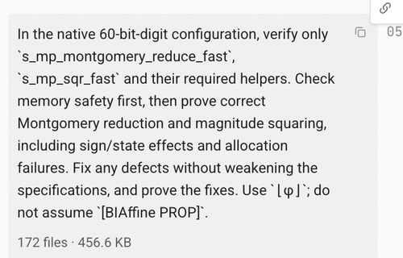

---
title:  'Awesome Iris Lean'
date: 'Oct 29, 2026'
content: 'Iris'
...

This page will be periodically updated with the awesome people I know to be using Iris-Lean. 

At least, the ones who aren't in stealth 😉

## Academia
- [\[ CTE \]](https://github.com/markusdemedeiros/Metrology/tree/main/Metrology/TotalEris) A continuous probabilistic program logic
    - As described in the Iris-Lean paper, this logic admits new proof rules by virtue of its access to Mathlib.
- [\[ BPPL \]](https://github.com/edwin1729/bppl-logic) A formalization of the Lilac probabilistic separation logic
    - Before this project, Lilac was not formalized in a theorem prover.
- [\[ Iris-Tutorial \]](https://github.com/suhr/iris-tutorial) A work in progress port of the Iris tutorial 
- [\[ pcOL \]](https://github.com/zilberstein/pcol-iris/tree/main) Probabilistic Concurrent Outcome Logic (pcOL)
- [\[ Perennial \]](https://github.com/mit-pdos/perennial/tree/lean) A program logic for distributed Go programs
- [\[ MachCSL \]](https://github.com/mit-pdos/xv6iris/tree/lean/MachCSL) A separation logic for verifying the correctness of an operating system

     > Porting to Lean. After we had finished doing all of this verification work in Rocq, we asked an agent to port the whole verification framework and proofs to Lean. This required some supervision, but far less than the original development. The resulting Lean port was about half the size of the Rocq development, in terms of lines of proof, and it compiled (checking all of the proofs) about 5x faster, through a combination of cleanup, simplifications, and better optimizations in Lean itself. (This paper, including all of the reported numbers, describes the original Rocq development.)
     >
     > One surprising finding is that, when one of the authors of this paper switched the git repo from Rocq to Lean, the other author barely noticed (aside from the performance improvements), since the level of discussion with the agent was far above the specific syntax differences between Rocq and Lean; the agent was able to switch all of its work from Rocq to Lean transparently.
     >
     > - _Kaashoek and Zeldovich, "Extending concurrent separation logic to the hardware level to verify the xv6 OS kernel on RISC-V with AI agents"._
- [\[ CatCrypt \]](https://github.com/spitters/CatCrypt-core) Game-based cryptographic security proofs
- [\[ Lantana \]](https://github.com/mit-pdos/lantana) A (transfinite) concurrent separation logic for liveness
- [\[ Wander \]](https://github.com/ayhon/wander) Diaframe-inspired ProofMode automation
- [\[ ISTA ITrees \]](https://github.com/ISTA-PLV/iris-lean/tree/wpi) _Program Logics a la Carte_
    - Being merged into Iris-Lean core.

## Industry
- [\[ Ship Your Interpreter \]](https://github.com/BasisResearch/ship-your-interpreter) Defining program semantics from an interpreter binary
    - Initially written without Iris-Lean. Got stuck on scaling up; switching to Iris-Lean helped surpass that barrier.
- [\[ Foxglove \]](https://github.com/Verified-zkEVM/Foxglove) Probabilistic separation logic; Etherium foundation
    - Combines probabilistic separation logic with VCVio's security oracles
- _(unconfirmed)_ [\[ Aristotle for C \]](https://www.harmonic.fun/news/aristotle-software-hardware-verification/)
    - They didn't say as much, but an early version of their website had a funny tell:
    {width=60%}
- _(unconfirmed)_ [\[ &Truth \]](https://andtruth.com/blog/shoulders-of-giants/)
    - On their website, they say:

      > A new version of Iris for Lean is a crucial building block in the logical foundations of &Truth's tools.

      I don't know if they use Iris-Lean, but I'll settle for being crucial.

## Hey, where am I?

If you're using Iris-Lean to do awesome things, email `mjd9606@nyu.edu` with a link to your project.

Iris-Lean builds off of a lot of awesome [\[ Iris \]](https://iris-project.org#publications). You should check out the developments there, and when you're inspired enough, build your next project with [\[ Iris-Lean \]](https://github.com/leanprover-community/iris-lean).